# TaskFlow — dépôt fil rouge CI/CD

TaskFlow est une petite API de gestion de tâches écrite en Python avec FastAPI.
C'est le projet fil rouge du module CI/CD (Mastère DevOps M1, Sup de Vinci) :
pendant trois jours, vous allez construire autour d'elle un pipeline complet
qui teste, construit, sécurise et livre l'application.

## Lancer l'API en local

Prérequis : Python 3.10 ou plus récent.

```bash
python3 -m venv .venv
source .venv/bin/activate          # Windows : .venv\Scripts\activate
pip install -r requirements-dev.txt
uvicorn app.main:app --reload
```

L'API répond sur http://localhost:8000 et sa documentation interactive est sur
http://localhost:8000/docs.

## Vérifier le code

```bash
pytest           # tests automatiques
ruff check .     # lint
ruff format .    # mise en forme
```

## Lancer avec Docker

```bash
docker build -t taskflow .
docker run --rm -p 8000:8000 taskflow
```

## Endpoints

| Méthode | Chemin | Rôle |
| --- | --- | --- |
| GET | `/health` | État de l'API et version |
| GET | `/tasks` | Liste des tâches |
| GET | `/tasks/search?q=...` | Recherche dans les titres |
| POST | `/tasks` | Crée une tâche (`{"title": "..."}`) |
| GET | `/tasks/{id}` | Détail d'une tâche |
| PATCH | `/tasks/{id}/done` | Marque une tâche comme faite |
| DELETE | `/tasks/{id}` | Supprime une tâche (en-tête `X-API-Token` requis) |

## Configuration

| Variable | Rôle | Défaut |
| --- | --- | --- |
| `APP_VERSION` | Version affichée par `/health` | `0.1.0` |
| `DB_PATH` | Fichier SQLite | `taskflow.db` |
| `API_TOKEN` | Jeton exigé pour supprimer une tâche | vide (suppression désactivée) |
| `NOTIFY_WEBHOOK_URL` | Webhook appelé à chaque création de tâche | vide (désactivé) |


## Équipe

- Boulaye — [@Darkbd11](https://github.com/Darkbd11)
- [@Daryl-6](https://github.com/Daryl-6)


## Gouvernance du dépôt

J'ai configuré le ruleset **Protection main**, avec le statut **Active**, une liste de contournement vide et la branche `main` comme cible.

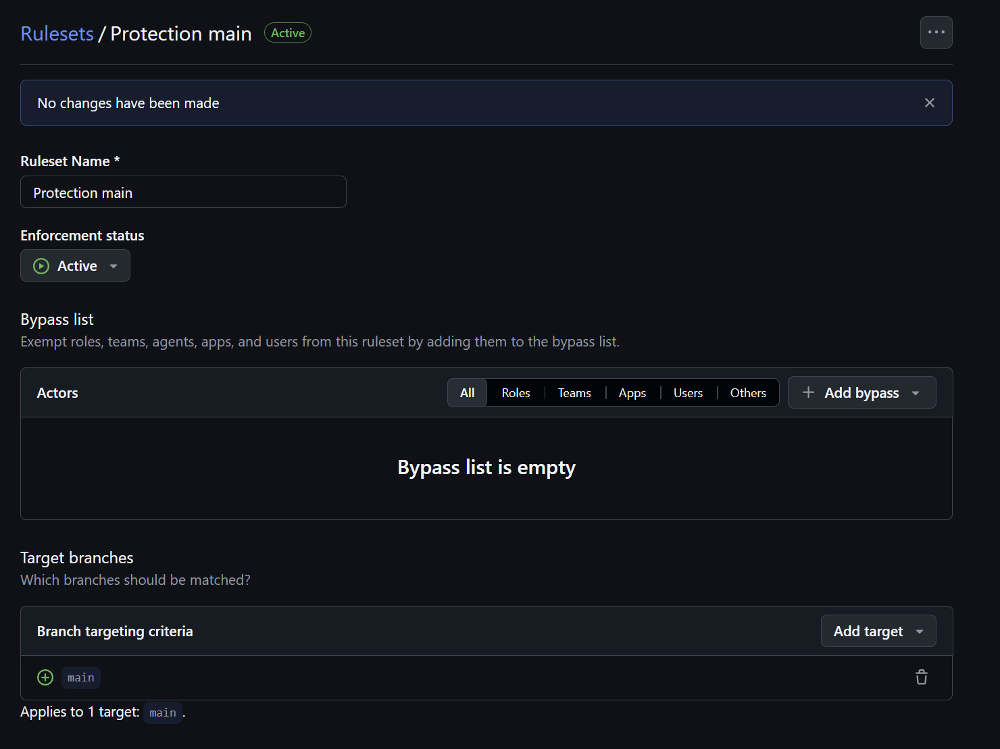

La capture suivante montre le ciblage de `main`, l'interdiction de supprimer la branche et la PR obligatoire. Le check `Tests` visible en bas est expliqué dans la partie 2 sur le pipeline CI.

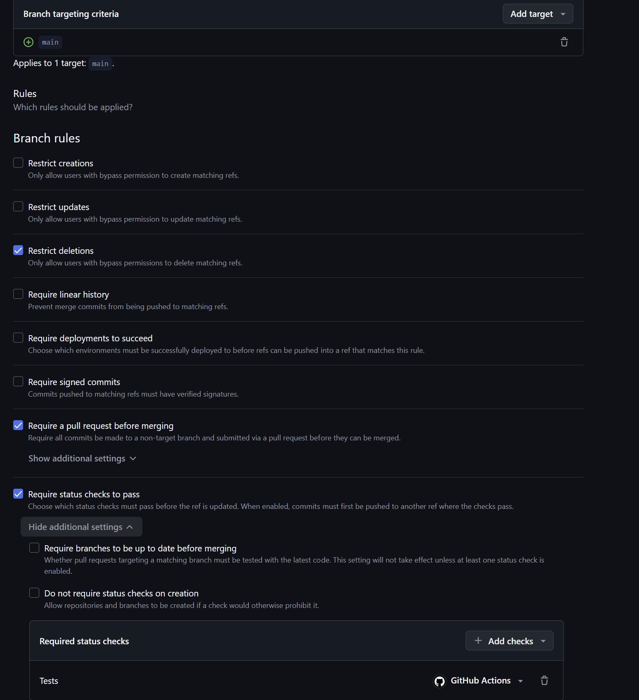

Chaque règle a un objectif précis :

| Règle | Pourquoi l'utiliser ? |
| --- | --- |
| Pull request obligatoire | Faire passer les modifications par une demande de fusion traçable. |
| Au moins une approbation | Obtenir la relecture du binôme avant l'intégration. |
| Force push interdit | Empêcher la réécriture forcée de l'historique de `main`. |
| Suppression de la branche interdite | Préserver la branche principale du projet. |
| Revue des Code Owners obligatoire | Faire valider les modifications des fichiers sensibles par leurs responsables. |

La capture ci-dessous montre la PR obligatoire, le nombre d'approbations fixé à **1** et l'option **Require review from Code Owners** activée.

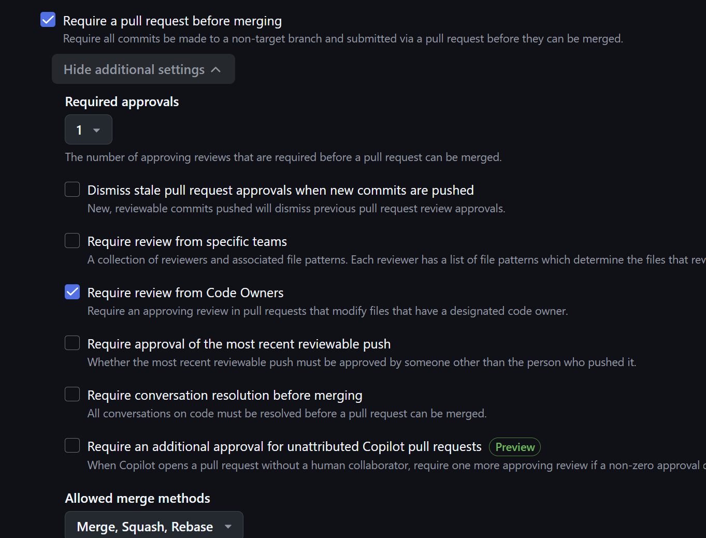

### 3. Test du push direct : refus attendu

Pour vérifier la protection, j'ai créé un commit vide sur `main`, puis tenté un push direct :

```bash
git commit --allow-empty -m "Test verification de la protection"
git push origin main
```

GitHub refuse le push avec l'erreur `GH013` et le message :

```text
Changes must be made through a pull request.
```

Ce refus confirme que la règle s'applique : les modifications doivent passer par une PR avant d'arriver sur `main`. Le commit de test `e6e2f20` reste local après le refus ; il peut ensuite être publié sur la branche de travail.

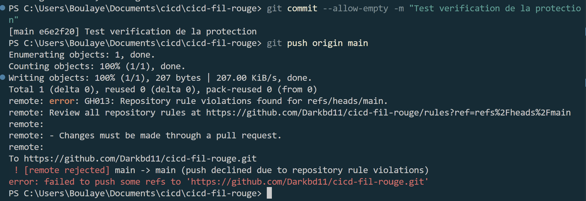

### 4. Modification du README et approbation du binôme

J'ai créé la branche `feat/readme-equipe` pour ajouter l'équipe et la gouvernance du dépôt au README, puis publié cette branche :

```bash
git switch -c feat/readme-equipe
git add README.md
git commit -m "equipe et gouvernance du depot"
git push -u origin feat/readme-equipe
```

J'ai ouvert la [PR #1](https://github.com/Darkbd11/cicd-fil-rouge/pull/1) vers `main` de mon fork. Daryl-6 a relu et approuvé les modifications : la capture montre **Changes approved** et le bouton de fusion disponible.

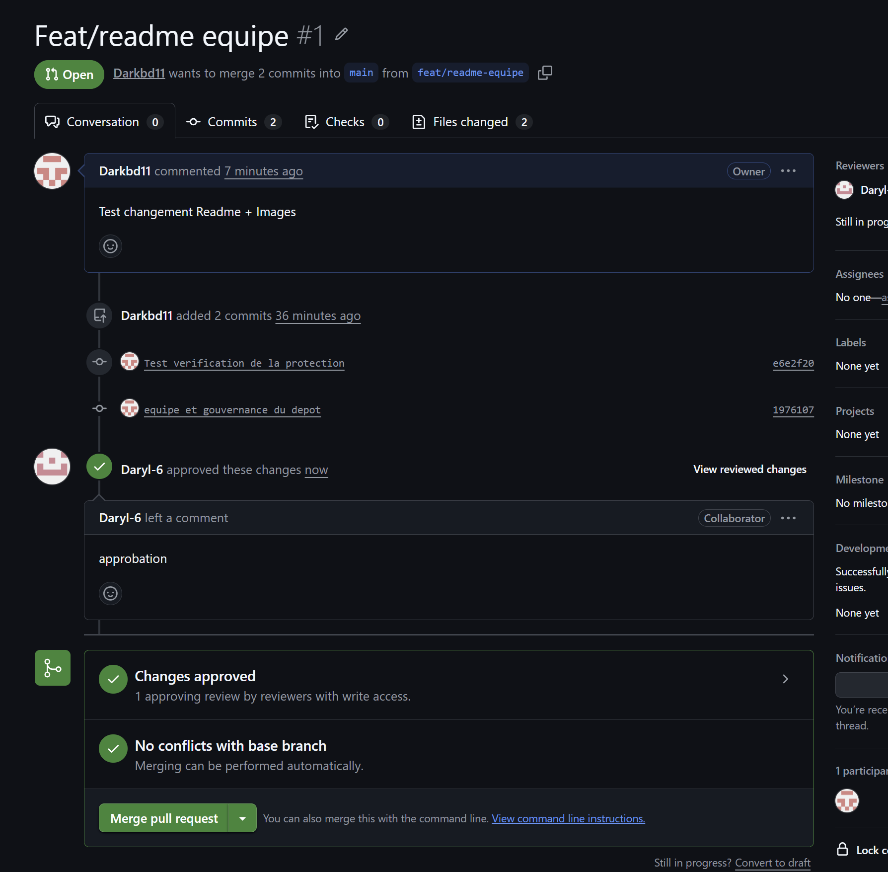

La PR a ensuite été fusionnée. L'historique présenté à l'étape 6 montre le commit de fusion `0e57228`, intitulé « Merge pull request #1 from Darkbd11/feat/readme-equipe ».

### 5. Protection des workflows avec CODEOWNERS

J'ai ajouté le fichier `.github/CODEOWNERS` pour désigner les responsables des workflows et du fichier CODEOWNERS lui-même :

```text
# Responsables du fichier qui définit les propriétaires
/.github/CODEOWNERS @Darkbd11 @Daryl-6

# Responsables des workflows GitHub Actions
/.github/workflows/ @Darkbd11 @Daryl-6
```

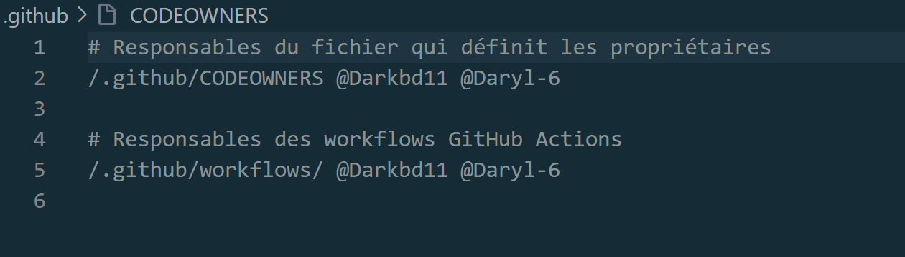

Ce fichier indique à GitHub les personnes responsables des chemins concernés. Avec **Require review from Code Owners** activé, une modification de ces fichiers nécessite l'approbation d'un propriétaire du code ; l'auteur de la PR ne peut pas approuver sa propre modification.

Les changements ont été proposés dans la branche `chore/codeowners`, via la [PR #2](https://github.com/Darkbd11/cicd-fil-rouge/pull/2). Avant approbation, GitHub bloque la fusion : la capture montre **Review required** et **At least 1 approving review is required**.

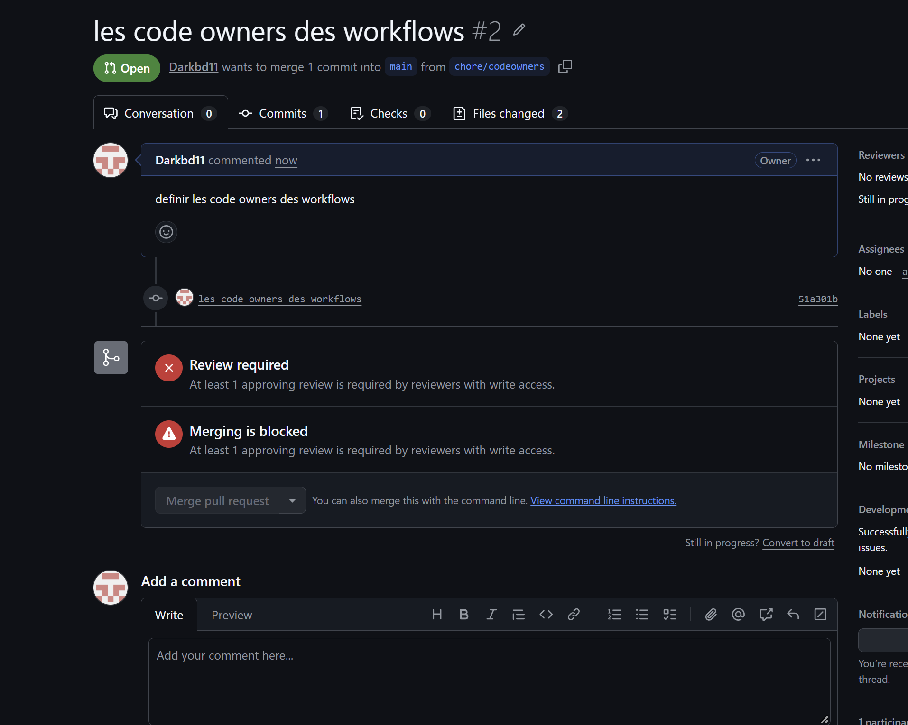

Cette PR a ensuite été fusionnée. Le commit de fusion `c8a8aec` apparaît dans l'historique de l'étape suivante.

### 6. Bonus : signature des commits avec une clé SSH

J'ai créé une clé SSH dédiée à la signature, nommée `id_ed25519_cicd_signing`, enregistré sa clé publique comme clé de signature sur GitHub et configuré Git pour signer mes commits.

J'ai vérifié le résultat sur la branche `test/signature-ssh`. Le commit `809e0d9`, intitulé « verifier la signature SSH », affiche le badge **Verified** : GitHub reconnaît sa signature.

La même capture montre aussi les fusions des PR #1 et #2.

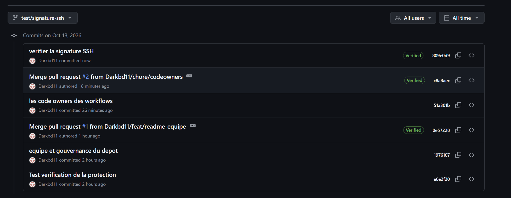

### Résultat de la partie 1

| Vérification | Résultat |
| --- | --- |
| Push direct sur `main` | Refusé avec `GH013`. |
| PR README | Approuvée par Daryl-6, puis fusionnée. |
| PR CODEOWNERS | Fusion bloquée avant approbation, puis PR fusionnée. |
| Revue des Code Owners | Activée dans la protection de `main`. |
| Bonus signature SSH | Commit `809e0d9` reconnu **Verified**. |

## Pipeline CI

L'objectif de cette partie est d'accélérer les contrôles automatiques tout en conservant les tests obligatoires avant la fusion dans `main`.

### 1. Création de la branche

Je suis parti de la branche `main` à jour, puis j'ai créé une branche dédiée à la modification du pipeline :

```bash
git switch main
git pull --ff-only origin main
git switch -c feat/ci-rapide
git status
```

Les modifications de la CI sont effectuées dans `.github/workflows/ci.yml`.

### 2. Premier contrôle sans cache

J'ai commencé par une version simple du workflow, avec Python 3.11 et une installation des dépendances sans cache. Le job récupère le code, installe Python et les dépendances, vérifie le code avec Ruff, puis exécute les tests avec pytest.

La capture montre que toutes ces étapes réussissent. Le job `Tests` dure **13 secondes** ; cette valeur correspond au job complet, pas uniquement à l'installation des dépendances.

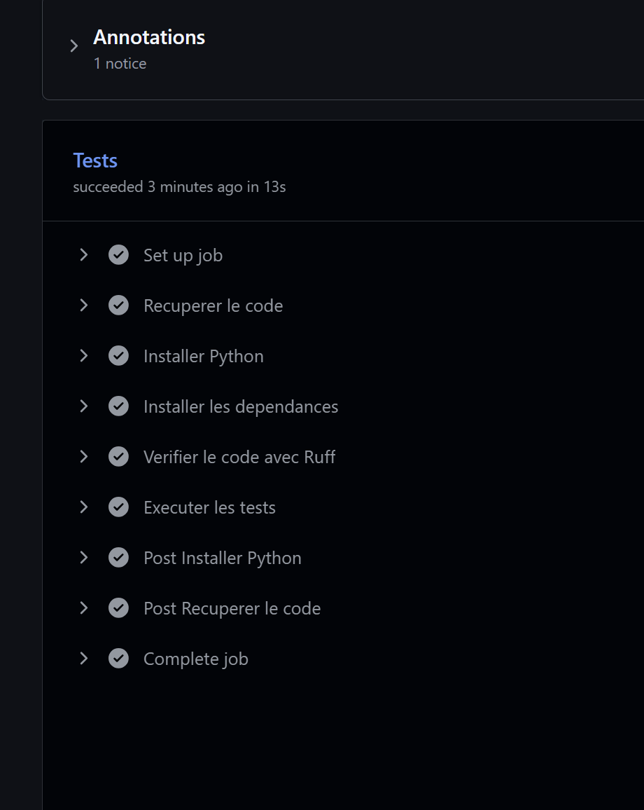

### 3. Ajout de la matrice et des optimisations

Le second commit, `761540f`, est intitulé « Ajout des matrice de python cache pip et rapports ». L'évolution demandée dans l'exercice comprend :

| Élément | Utilité |
| --- | --- |
| Matrice Python 3.11, 3.12 et 3.13 | Tester le projet avec les trois versions de Python. |
| Cache pip | Réutiliser les paquets téléchargés lors des exécutions suivantes. |
| Rapport de tests en artefact | Conserver un rapport téléchargeable après l'exécution. |
| Concurrency | Annuler une exécution devenue obsolète lorsqu'une nouvelle exécution du même groupe démarre. |

La capture de la PR confirme que les trois versions de Python passent les contrôles. La restauration effective du cache, la configuration de la concurrence et la publication du rapport doivent être vérifiées dans le workflow et ses journaux.

### 4. Configuration du check obligatoire

J'ai configuré la protection de `main` pour exiger la réussite du check `Tests` avant la fusion. La capture montre également que les force pushes sont bloqués.

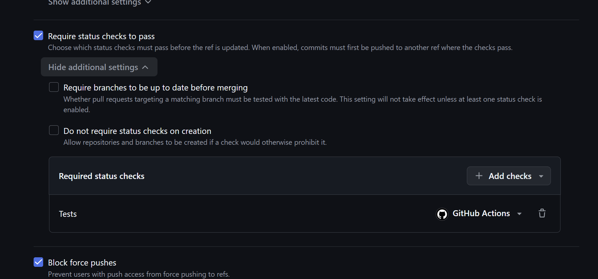

### 5. Pourquoi la PR reste bloquée malgré les tests verts

J'ai ouvert la PR #5 de `feat/ci-rapide` vers `main`. Six contrôles réussissent : un pour chaque version de Python sur `push`, puis un pour chaque version sur `pull_request`.

La PR reste néanmoins bloquée pour deux raisons :

- La règle exige toujours un check nommé exactement `Tests`, alors que la matrice publie `Tests (Python 3.11)`, `Tests (Python 3.12)` et `Tests (Python 3.13)`. L'ancien check reste donc au statut **Expected**.
- L'approbation du propriétaire du code **Daryl-6** est encore requise.

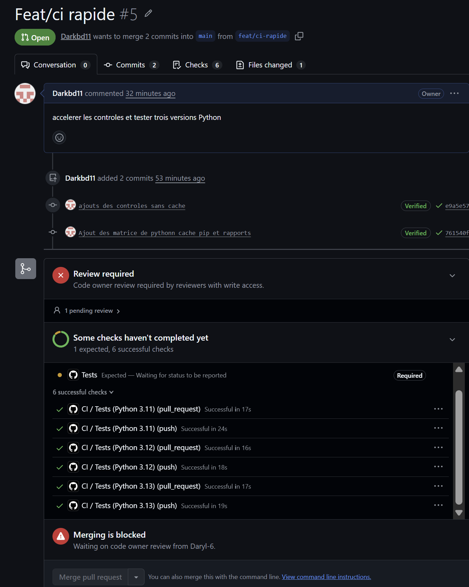

### 6. Rôle du job CI OK — correction à finaliser

Le job **CI OK** attend la fin de tous les jobs de la matrice et ne réussit que si tous les contrôles réussissent. Son nom reste fixe même si la matrice évolue, ce qui permet d'en faire le seul check obligatoire pour autoriser la fusion.

Pour finaliser la correction, il faut ajouter ce job de synthèse au workflow, le faire s'exécuter même en cas d'échec d'un job dépendant et lui faire retourner un échec si la matrice n'a pas entièrement réussi. Après son apparition dans les checks, il faut remplacer l'ancien check obligatoire `Tests` par `CI OK` dans la règle de protection de `main`.

L'approbation de Daryl reste une condition distincte. La dernière capture fournie montre l'état avant cette correction.

### 7. Comparaison des durées avec et sans cache

La comparaison demandée porte sur l'étape **Installer les dépendances**, avec la même version de Python et les mêmes dépendances.

| Mesure — Python 3.11 | Sans cache | Avec cache effectivement restauré |
| --- | --- | --- |
| Durée de l'installation des dépendances | **À mesurer : … s** | **À mesurer : … s** |
| Gain | — | **À calculer : … s** |

Dans GitHub Actions, ouvrir les détails du job et relever la durée de l'étape d'installation. Pour la mesure avec cache, vérifier d'abord dans l'étape de configuration de Python que le cache est restauré ; la première exécution avec cache activé peut seulement le créer.

Les seules durées actuellement visibles dans les captures sont celles des jobs complets :

| Job | Sans cache | Matrice — push | Matrice — pull request |
| --- | --- | --- | --- |
| Python 3.11 | 13 s | 24 s | 17 s |
| Python 3.12 | — | 18 s | 16 s |
| Python 3.13 | — | 19 s | 17 s |

Ces valeurs ne permettent pas de conclure à un gain sur l'installation.

### 8. Téléchargement de l'artefact — à confirmer

Dans **Actions**, ouvrir l'exécution du workflow, puis télécharger le rapport dans la section **Artifacts** du résumé. Vérifier que l'archive contient le rapport de tests.

**Preuve à ajouter :** nom de l'artefact téléchargé et capture du résumé du run montrant le rapport. Les trois captures actuelles ne montrent pas ce téléchargement.

### 9. Bonus : badge de statut

Ce badge affiche le statut du workflow `ci.yml` sur la branche de l'exercice :

[](https://github.com/Darkbd11/cicd-fil-rouge/actions/workflows/ci.yml?query=branch%3Afeat%2Fci-rapide)

Après la fusion, le badge pourra être configuré sur `main`.
