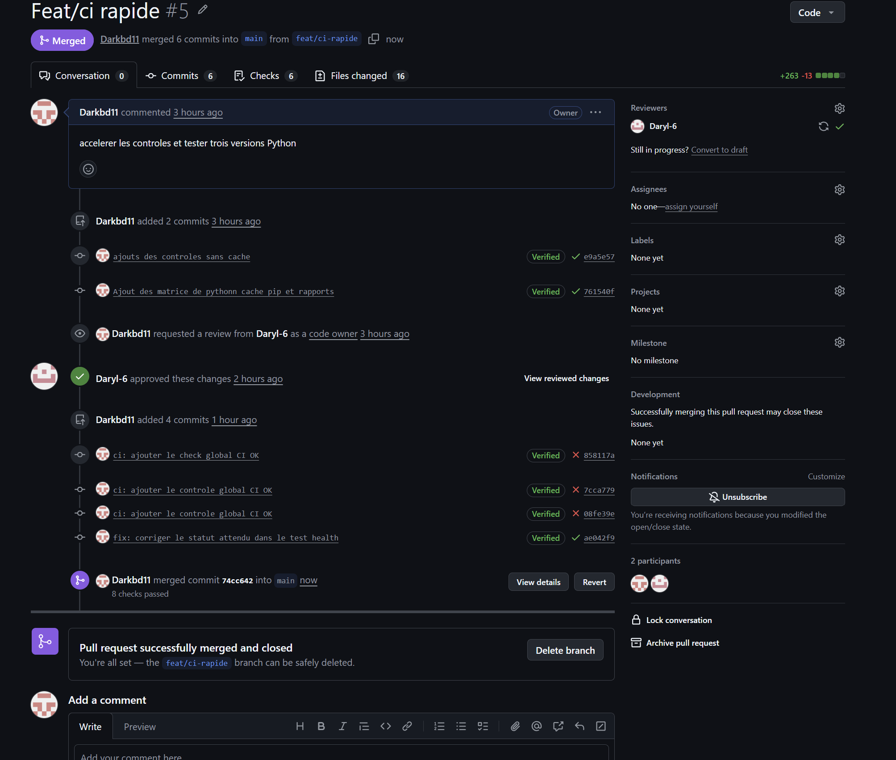
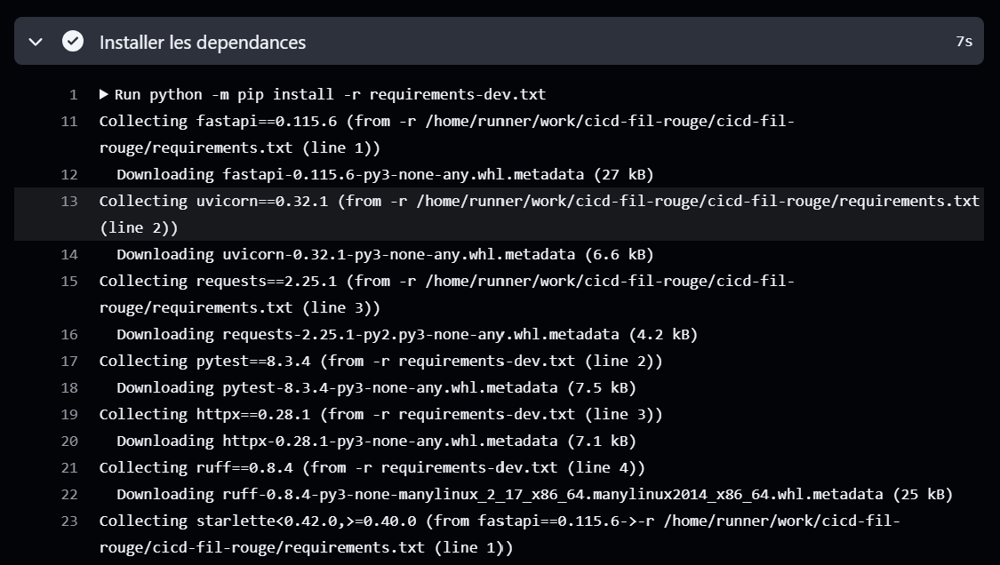
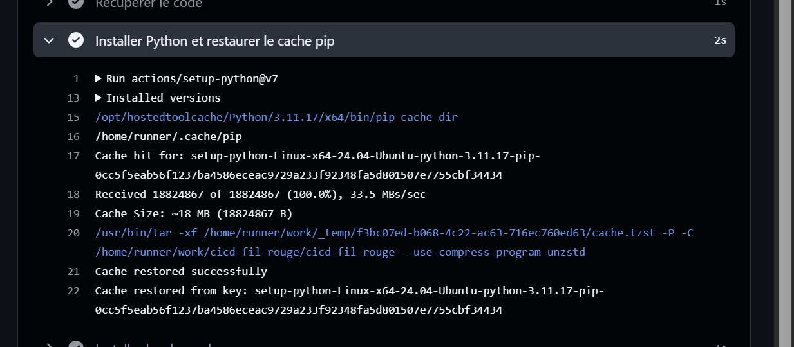
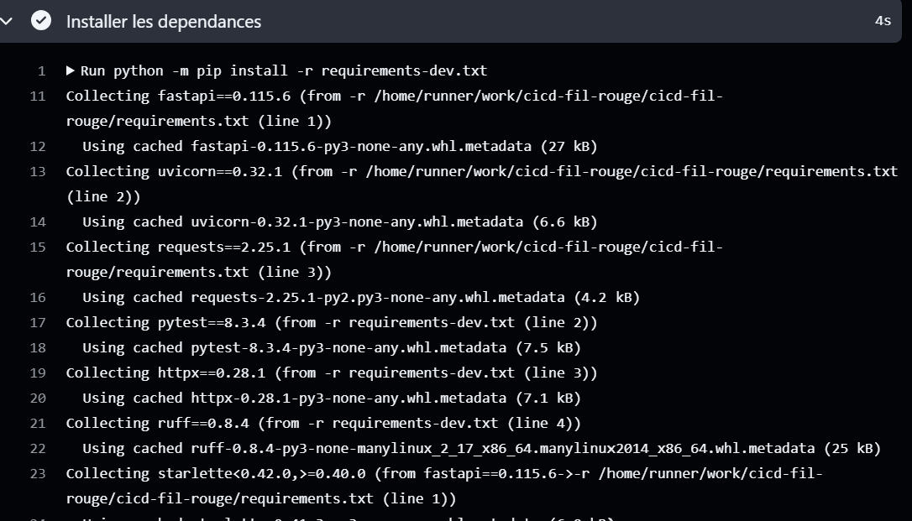
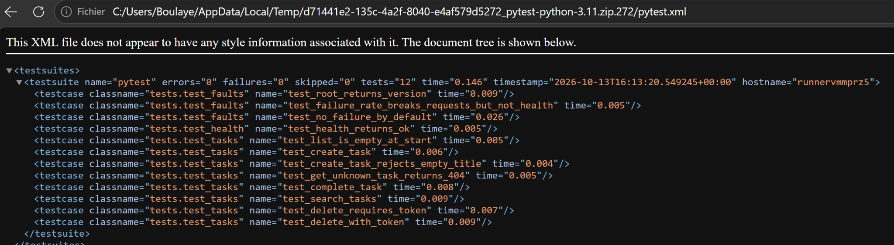

# TaskFlow — dépôt fil rouge CI/CD

TaskFlow est une petite API de gestion de tâches écrite en Python avec FastAPI.
C'est le projet fil rouge du module CI/CD (Mastère DevOps M1, Sup de Vinci) :
pendant trois jours, vous allez construire autour d'elle un pipeline complet
qui teste, construit, sécurise et livre l'application.

## Lancer l'API en local

Prérequis : Python 3.10 ou plus récent.

```bash
python3 -m venv .venv
source .venv/bin/activate          # Windows : .venv\Scripts\activate
pip install -r requirements-dev.txt
uvicorn app.main:app --reload
```

L'API répond sur http://localhost:8000 et sa documentation interactive est sur
http://localhost:8000/docs.

## Vérifier le code

```bash
pytest           # tests automatiques
ruff check .     # lint
ruff format .    # mise en forme
```

## Lancer avec Docker

```bash
docker build -t taskflow .
docker run --rm -p 8000:8000 taskflow
```

## Endpoints

| Méthode | Chemin | Rôle |
| --- | --- | --- |
| GET | `/health` | État de l'API et version |
| GET | `/tasks` | Liste des tâches |
| GET | `/tasks/search?q=...` | Recherche dans les titres |
| POST | `/tasks` | Crée une tâche (`{"title": "..."}`) |
| GET | `/tasks/{id}` | Détail d'une tâche |
| PATCH | `/tasks/{id}/done` | Marque une tâche comme faite |
| DELETE | `/tasks/{id}` | Supprime une tâche (en-tête `X-API-Token` requis) |

## Configuration

| Variable | Rôle | Défaut |
| --- | --- | --- |
| `APP_VERSION` | Version affichée par `/health` | `0.1.0` |
| `DB_PATH` | Fichier SQLite | `taskflow.db` |
| `API_TOKEN` | Jeton exigé pour supprimer une tâche | vide (suppression désactivée) |
| `NOTIFY_WEBHOOK_URL` | Webhook appelé à chaque création de tâche | vide (désactivé) |


## Équipe

- Boulaye — [@Darkbd11](https://github.com/Darkbd11)

- [@Daryl-6](https://github.com/Daryl-6)

## Gouvernance du dépôt

### 1. Activation de la protection de main

J'ai configuré le ruleset **Protection main**, avec le statut **Active**, une liste de contournement vide et la branche `main` comme cible.


La capture suivante montre le ciblage de `main`, l'interdiction de supprimer la branche et la PR obligatoire. Le check `Tests` visible en bas est expliqué dans la partie 2 sur le pipeline CI.


### 2. Règles et revues obligatoires

Chaque règle a un objectif précis :

| Règle | Pourquoi l'utiliser ? |
| --- | --- |
| Pull request obligatoire | Faire passer les modifications par une demande de fusion traçable. |
| Au moins une approbation | Obtenir la relecture du binôme avant l'intégration. |
| Force push interdit | Empêcher la réécriture forcée de l'historique de `main`. |
| Suppression de la branche interdite | Préserver la branche principale du projet. |
| Revue des Code Owners obligatoire | Faire valider les modifications des fichiers sensibles par leurs responsables. |

La capture ci-dessous montre la PR obligatoire, le nombre d'approbations fixé à **1** et l'option **Require review from Code Owners** activée.


### 3. Test du push direct : refus attendu

Pour vérifier la protection, j'ai créé un commit vide sur `main`, puis tenté un push direct :

```bash
git commit --allow-empty -m "Test verification de la protection"
git push origin main
```

GitHub refuse le push avec l'erreur `GH013` et le message :

```text
Changes must be made through a pull request.
```

Ce refus confirme que la règle s'applique : les modifications doivent passer par une PR avant d'arriver sur `main`. Le commit de test `e6e2f20` reste local après le refus ; il peut ensuite être publié sur la branche de travail.


### 4. Modification du README et approbation du binôme

J'ai créé la branche `feat/readme-equipe` pour ajouter l'équipe et la gouvernance du dépôt au README, puis publié cette branche :

```bash
git switch -c feat/readme-equipe
git add README.md
git commit -m "equipe et gouvernance du depot"
git push -u origin feat/readme-equipe
```

J'ai ouvert la [PR #1](https://github.com/Darkbd11/cicd-fil-rouge/pull/1) vers `main` de mon fork. Daryl-6 a relu et approuvé les modifications : la capture montre **Changes approved** et le bouton de fusion disponible.


La PR a ensuite été fusionnée. L'historique présenté à l'étape 6 montre le commit de fusion `0e57228`, intitulé « Merge pull request #1 from Darkbd11/feat/readme-equipe ».

### 5. Protection des workflows avec CODEOWNERS

J'ai ajouté le fichier `.github/CODEOWNERS` pour désigner les responsables des workflows et du fichier CODEOWNERS lui-même :

```text
# Responsables du fichier qui définit les propriétaires
/.github/CODEOWNERS @Darkbd11 @Daryl-6
# Responsables des workflows GitHub Actions
/.github/workflows/ @Darkbd11 @Daryl-6
```


Ce fichier indique à GitHub les personnes responsables des chemins concernés. Avec **Require review from Code Owners** activé, une modification de ces fichiers nécessite l'approbation d'un propriétaire du code ; l'auteur de la PR ne peut pas approuver sa propre modification.

Les changements ont été proposés dans la branche `chore/codeowners`, via la [PR #2](https://github.com/Darkbd11/cicd-fil-rouge/pull/2). Avant approbation, GitHub bloque la fusion : la capture montre **Review required** et **At least 1 approving review is required**.


Cette PR a ensuite été fusionnée. Le commit de fusion `c8a8aec` apparaît dans l'historique de l'étape suivante.

### 6. Bonus : signature des commits avec une clé SSH

J'ai créé une clé SSH dédiée à la signature, nommée `id_ed25519_cicd_signing`, enregistré sa clé publique comme clé de signature sur GitHub et configuré Git pour signer mes commits.

J'ai vérifié le résultat sur la branche `test/signature-ssh`. Le commit `809e0d9`, intitulé « verifier la signature SSH », affiche le badge **Verified** : GitHub reconnaît sa signature.

La même capture montre aussi les fusions des PR #1 et #2.


### Résultat de la partie 1

| Vérification | Résultat |
| --- | --- |
| Push direct sur `main` | Refusé avec `GH013`. |
| PR README | Approuvée par Daryl-6, puis fusionnée. |
| PR CODEOWNERS | Fusion bloquée avant approbation, puis PR fusionnée. |
| Revue des Code Owners | Activée dans la protection de `main`. |
| Bonus signature SSH | Commit `809e0d9` reconnu **Verified**. |

## Pipeline CI

L'objectif de cette partie est d'accélérer les contrôles automatiques tout en conservant les tests obligatoires avant la fusion dans `main`. Le workflow est défini dans [`.github/workflows/ci.yml`](.github/workflows/ci.yml).

### 1. Création de la branche

Je suis parti de la branche `main` à jour, puis j'ai créé une branche dédiée à la modification du pipeline :

```bash
git switch main
git pull --ff-only origin main
git switch -c feat/ci-rapide
git status
```

Les modifications ont été réalisées sur `feat/ci-rapide`, puis proposées dans une pull request vers `main`.

### 2. Premier contrôle sans cache

J'ai commencé par une version simple du workflow, avec Python 3.11 et une installation des dépendances sans cache. Le job récupère le code, installe Python et les dépendances, vérifie le code avec Ruff, puis exécute les tests avec pytest.

La première exécution réussit. Le job `Tests` dure **13 secondes**, dont **7 secondes pour l'installation des dépendances**. Ces deux durées correspondent à des périmètres différents ; la comparaison du cache à l'étape 8 utilise uniquement l'installation.


### 3. Ajout de la matrice et des optimisations

Le commit `761540f`, intitulé « Ajout des matrice de python cache pip et rapports », introduit les évolutions du pipeline. La configuration finale comprend les éléments suivants :

| Élément | Configuration et utilité |
| --- | --- |
| Matrice Python | Exécuter les contrôles avec Python **3.11, 3.12 et 3.13**. |
| Cache pip | Réutiliser les paquets téléchargés grâce à `cache: pip` dans `actions/setup-python`. Les fichiers `requirements.txt` et `requirements-dev.txt` servent au calcul de la clé de cache. |
| Installation | Installer les dépendances avec `python -m pip install -r requirements-dev.txt`. Le cache accélère cette étape, mais ne la remplace pas. |
| Analyse du code | Exécuter `python -m ruff check .` dans chaque job de la matrice. |
| Tests et rapport | Exécuter `python -m pytest -q --junitxml=reports/pytest.xml`. |
| Artefacts | Conserver un rapport par version de Python sous les noms `pytest-python-3.11`, `pytest-python-3.12` et `pytest-python-3.13`, pendant **7 jours**. |
| Concurrency | Regrouper les exécutions par workflow et référence Git, puis annuler l'exécution précédente du même groupe avec `cancel-in-progress: true`. |
| Gestion des échecs | Avec `fail-fast: false`, l'échec d'une version de Python n'interrompt pas les autres jobs de la matrice. |

Le workflow se déclenche sur les pushes vers `main` et `feat/ci-rapide`, ainsi que sur les pull requests vers `main`. Il dispose uniquement de la permission `contents: read` et chaque job de tests a un délai maximal de **10 minutes**.

L'étape de publication du rapport utilise `if: always()` pour être tentée même si une étape précédente échoue. Si aucun rapport n'a été généré, `if-no-files-found: error` signale son absence.

### 4. Configuration initiale du check obligatoire

J'ai d'abord configuré la protection de `main` pour exiger la réussite du check `Tests` avant la fusion. La capture montre également que les force pushes sont bloqués.


Cette capture correspond à la configuration initiale. Le check obligatoire a ensuite été remplacé par `CI OK`, comme expliqué à l'étape 6.

### 5. Pourquoi la PR restait bloquée malgré les tests verts

J'ai ouvert la [PR #5](https://github.com/Darkbd11/cicd-fil-rouge/pull/5) de `feat/ci-rapide` vers `main`. Dans un premier temps, six contrôles réussissaient : un pour chaque version de Python sur `push`, puis un pour chaque version sur `pull_request`.

La PR restait néanmoins bloquée pour deux raisons :

- La règle exigeait un check nommé exactement `Tests`, alors que la matrice publiait `Tests (Python 3.11)`, `Tests (Python 3.12)` et `Tests (Python 3.13)`. L'ancien check restait donc au statut **Expected**.
- L'approbation du propriétaire du code **Daryl-6** était encore requise.


### 6. Correction avec le job CI OK

Le job **CI OK** attend le résultat de toute la matrice et ne réussit que si les contrôles des trois versions de Python réussissent. Son nom reste fixe même si la matrice évolue, ce qui permet d'en faire le seul check de statut obligatoire dans la protection de `main`.

J'ai ajouté le job suivant au workflow :

```yaml
ci-ok:
    name: CI OK
    runs-on: ubuntu-latest
    needs: [tests]
    if: ${{ always() }}

    steps:
        - name: Verifier le resultat de la matrice
          env:
              TESTS_RESULT: ${{ needs.tests.result }}
          run: |
              if [ "$TESTS_RESULT" != "success" ]; then
                  echo "La matrice n'a pas reussi : $TESTS_RESULT"
                  exit 1
              fi
              echo "Tous les controles ont reussi."
```

Ce bloc se trouve sous `jobs:`, au même niveau que le job `tests`.

- `needs: [tests]` attend le résultat de la matrice.
- `if: ${{ always() }}` permet d'évaluer ce résultat même si les tests ont échoué.
- Le script retourne un échec dès que le résultat diffère de `success`, notamment en cas d'échec, d'annulation ou de tests ignorés.

Dans la protection de `main`, j'ai remplacé l'ancien check `Tests` par **CI OK**. L'approbation du binôme reste une condition distincte : un pipeline réussi ne remplace pas la revue du code.

### 7. Correction du test et fusion de la pull request

Pendant la validation, le test de la route `/health` attendait la valeur `"ko"`, alors que l'application renvoyait `"ok"`. Cet échec faisait échouer les jobs de tests et le contrôle `CI OK`, ce qui bloquait la fusion.

J'ai corrigé la valeur attendue dans `tests/test_health.py` :

```python
def test_health_returns_ok(client):
    response = client.get("/health")
    assert response.status_code == 200
    assert response.json()["status"] == "ok"
```

La correction a été enregistrée dans le commit `ae042f9`, intitulé « fix: corriger le statut attendu dans le test health ».

Après cette correction, **les 8 contrôles ont réussi** : les trois jobs de tests et `CI OK` pour chacun des deux événements, `push` et `pull_request`. La PR #5, approuvée par **Daryl-6**, a ensuite été fusionnée dans `main` avec le commit de fusion `74cc642`.



### 8. Comparaison des durées avec et sans cache

J'ai relevé la durée de l'étape **Installer les dépendances** dans les jobs utilisant **Python 3.11** :

| Mesure | Sans cache — CI #1 | Avec cache restauré — CI #10 |
| --- | --- | --- |
| Commit | `e9a5e57` | `ae042f9` |
| Installation des dépendances | **7 s** | **4 s** |
| Gain observé | Référence | **3 s**, soit environ **43 %** |

Calcul : `(7 - 4) / 7 × 100 ≈ 42,9 %`.

Ces mesures montrent un gain sur l'installation pour les deux exécutions observées. Elles ne représentent pas la durée totale du workflow et peuvent varier d'une exécution à l'autre.

**Sans cache :** l'étape d'installation dure 7 secondes.



**Vérification du cache :** les journaux de configuration de Python affichent `Cache hit for`, `Cache restored successfully` et `Cache restored from key`. Cela confirme qu'un cache existant a effectivement été restauré.



**Avec cache :** l'installation dure 4 secondes et les journaux indiquent `Using cached` pour les paquets réutilisés.



### 9. Téléchargement et vérification de l'artefact

Depuis le résumé de l'exécution dans **Actions**, j'ai téléchargé l'artefact **pytest-python-3.11** dans la section **Artifacts**, puis ouvert le fichier `pytest.xml` contenu dans l'archive ZIP.

Le rapport téléchargé indique :

| Champ du rapport | Valeur | Signification |
| --- | --- | --- |
| `tests` | **12** | Douze tests exécutés. |
| `failures` | **0** | Aucune assertion de test en échec. |
| `errors` | **0** | Aucune erreur d'exécution de test. |
| `skipped` | **0** | Aucun test ignoré. |

Les **12 tests ont donc réussi**. Le message du navigateur signalant l'absence de feuille de style est normal pour ce fichier XML et n'indique pas une erreur du rapport.



### 10. Bonus : badge de statut

Ce badge affiche le statut du workflow `ci.yml` sur la branche `main` :

[](https://github.com/Darkbd11/cicd-fil-rouge/actions/workflows/ci.yml)

### Résultat de la partie 2

| Vérification | Résultat |
| --- | --- |
| Matrice Python 3.11, 3.12 et 3.13 | Contrôles réussis sur les trois versions. |
| Cache pip | Restauration confirmée dans les journaux. |
| Temps d'installation | **7 s sans cache → 4 s avec cache**, soit **3 s gagnées** sur les mesures relevées. |
| Concurrency | Annulation des anciennes exécutions du même groupe configurée dans le workflow. |
| Check obligatoire | **CI OK**, dépendant de la réussite de toute la matrice. |
| Rapport de tests | Artefact `pytest-python-3.11` téléchargé ; **12 tests réussis**. |
| PR #5 | Approuvée par Daryl-6, puis fusionnée dans `main`. |
| Badge CI | Configuré sur `main` dans ce README. |